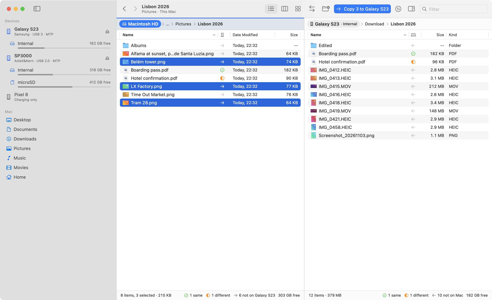
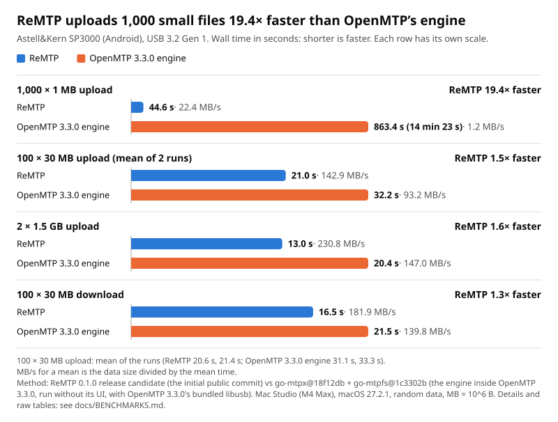
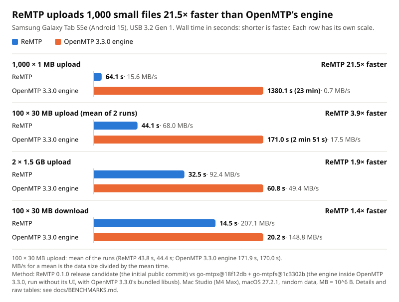
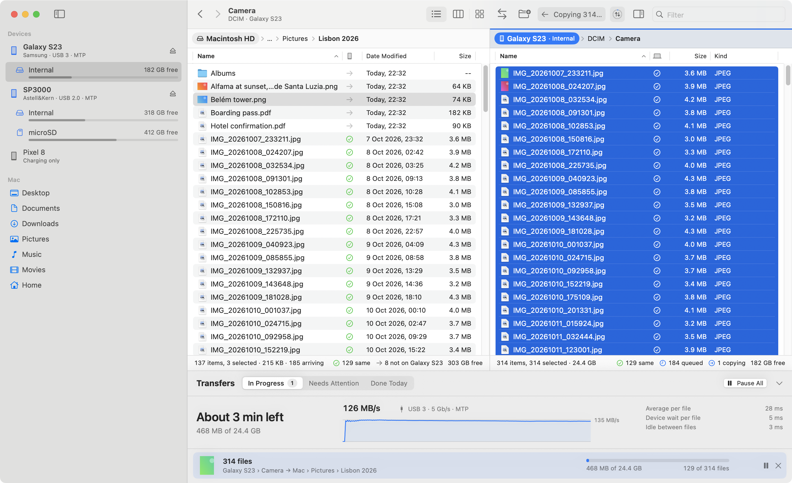
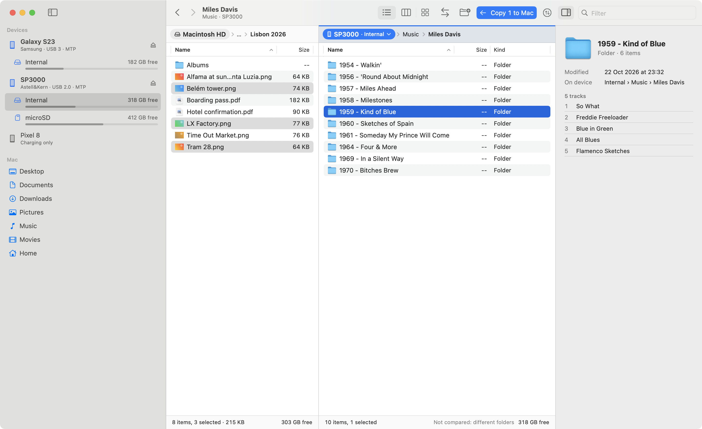
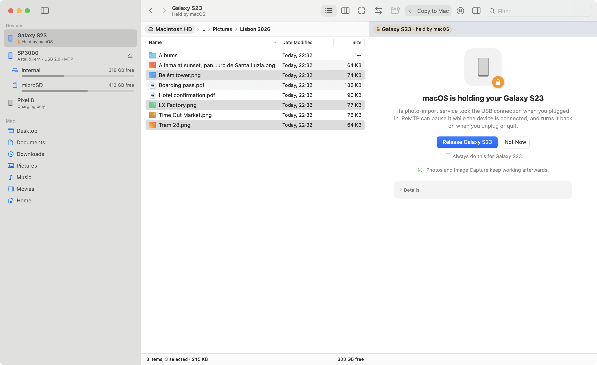

# ReMTP

A fast, native file manager for Android devices over USB: phones, tablets and Android-based audio
players. Two panes, Mac on one side and the device on the other, with copying that doesn't stall
between files.

[](https://github.com/cro13/ReMTP/actions/workflows/ci.yml)
[](LICENSE)


<picture>
  <source media="(prefers-color-scheme: dark)" srcset="design/screenshots/01-main-dark.png">
  
</picture>

**Status:** v0.1 is for macOS (Apple Silicon and Intel). A native Windows app and CLI on the same core
come later. Please file [device reports](https://github.com/cro13/ReMTP/issues/new?template=device_report.yml), even when
everything works.

## Why it's fast

Copying many files over MTP shouldn't take seconds per file. A correct MTP implementation spends tens
of milliseconds per file; the rest is your data moving at the speed of the cable. ReMTP plans the whole
copy up front, reads ahead from your disk while the device is busy, never re-lists folders between files,
and shows you exactly where the time goes (link speed, average per file, device wait).

<picture>
  <source media="(prefers-color-scheme: dark)" srcset="docs/benchmarks/studio-sp3000-dark.svg">
  
</picture>

<picture>
  <source media="(prefers-color-scheme: dark)" srcset="docs/benchmarks/studio-tab-s5e-dark.svg">
  
</picture>

On a Mac Studio over USB 3, ReMTP uploaded 1,000 × 1 MB files to an Astell&Kern SP3000 in 45 s against
14 min 23 s for OpenMTP 3.3.0's engine, and to a Galaxy Tab S5e in 64 s against 23 min. Uploads of 30 MB
and 1.5 GB files were 1.5–3.9× faster, and downloads 1.3–1.4×. An earlier round on an Intel iMac,
including a tablet that stock OpenMTP can't upload to at all, plus the method and every number:
[docs/BENCHMARKS.md](docs/BENCHMARKS.md).

## What's in 0.1

- **Two panes:** Mac and device side by side, each in a list, columns or icons view. Icons show
  thumbnails: Quick Look's for Mac files, the device's own for photos and videos on the device.
- **Navigation:** breadcrumbs, back/forward, keyboard navigation (Tab switches panes, ⌘↓ opens, ⌘↑ goes up,
  Space or ⌘Y for Quick Look on Mac files), type-to-select and filter by name.
- **Copy both ways** with drag and drop between the panes and with Finder (both directions), F5 or ⌘⇧←/→
  to copy to the other pane. Conflicts and bad names are found before any byte moves; choose Replace,
  Keep Both or Skip. Pause, resume and cancel per job or for all.
- **Transfers drawer:** speed, average time per file, device wait and idle time between files, plus a
  speed graph.
- **Compare column:** Same / Differs / Not on device, by name and size, against the folder open in the
  other pane.
- **Inspector:** preview (images, video, PDFs, cover art, device thumbnails), kind, size, dates, duration,
  and the track list of a music folder.
- **Device files:** new folder, rename, delete.
- **Storages:** internal storage and SD cards, with card-safe file names on removable storage.
- **Device access:** when macOS's photo service (`ptpcamerad`) holds the device, ReMTP says so and can
  pause it with one click while the device is connected. It turns it back on when you unplug or quit, and
  after a crash on the next launch.
- **USB mode:** with USB debugging on, a phone in "Charging only" still shows up, and ReMTP switches it to
  File transfer (and back) over ADB. Optionally switch a device back to Charging only on eject.
- **`remtp` CLI:** `devices`, `info`, `ls`, `push`, `pull`, `mkdir`, `rm`, `usb-mode`, `access`,
  `release`, `restore` and `bench`.

<details>
<summary>More screenshots</summary>

| Transfers | Inspector | Device access |
| --- | --- | --- |
| <picture><source media="(prefers-color-scheme: dark)" srcset="design/screenshots/03-transfers-dark.png"></picture> | <picture><source media="(prefers-color-scheme: dark)" srcset="design/screenshots/05-inspector-dark.png"></picture> | <picture><source media="(prefers-color-scheme: dark)" srcset="design/screenshots/06-access-dark.png"></picture> |

</details>

## Install

The first signed release (0.1.0) isn't out yet; until it is, [build from source](#build-from-source).
Releases will be on the [Releases](https://github.com/cro13/ReMTP/releases) page:

- `ReMTP-<version>-macos-arm64.dmg` (Apple Silicon) or `ReMTP-<version>-macos-x86_64.dmg` (Intel).
  macOS 14 or later. Every DMG is Developer ID signed and notarized.
- `remtp-cli-<version>-macos-{arm64,x86_64}.tar.gz` for the command-line tool (signed and notarized;
  unpacks to a folder with `remtp` and its license files).
- `SHA256SUMS.txt` to check the downloads.

First run:

- Unlock the device and set its USB mode to **File transfer**: tap the "Charging this device via USB"
  notification and pick File transfer. To make it stick, set Developer options → Default USB
  configuration → File transfer. With USB debugging on, ReMTP can switch it for you.
- If macOS's photo service holds the device, ReMTP shows who has it. Click **Release** to pause the
  service while you use ReMTP (Photos and Image Capture keep working afterwards), or quit the other app
  holding it. From the CLI: `remtp access <id>`, `remtp release <id>`, `remtp restore`.

## Try it without a device

Launch the app with `--demo` to get simulated devices with sample photos and music:

```sh
open -a ReMTP --args --demo
```

Copies are simulated. Files copied to the Mac arrive as empty placeholders of the right size, and a file
they replace goes to the Trash. Demo mode also shows Sync, as a preview of the planned feature.

## Roadmap

- Folder sync with a preview of every change before it runs
- ADB as an optional, faster transport
- Windows app and CLI on the same Rust core

## Build from source

Requirements: Xcode 16.4+ (which needs macOS 15.3 or later to run; the app itself runs on macOS 14+), Rust via [rustup](https://rustup.rs) (the toolchain is pinned in
`rust-toolchain.toml`), [XcodeGen](https://github.com/yonaskolb/XcodeGen) (`brew install xcodegen`).

```sh
cargo test --workspace --locked             # core, FFI and CLI; no device needed
cargo run --locked -p remtp-cli -- devices  # list connected devices
scripts/build-macos-core.sh                 # Rust static library + Swift bindings for the app
cd apps/macos && xcodegen generate && open ReMTP.xcodeproj
```

## Device reports and contributing

The most useful thing you can send is a [device report](https://github.com/cro13/ReMTP/issues/new?template=device_report.yml):
your device, Mac, cable and the output of `remtp bench`. For code, see [CONTRIBUTING.md](CONTRIBUTING.md)
and [docs/ARCHITECTURE.md](docs/ARCHITECTURE.md). Security problems: [SECURITY.md](SECURITY.md).

## How it's built

- `crates/remtp-core`: device sessions, transfer engine, card-safe names, USB mode switching, macOS
  device access (Rust)
- `crates/remtp-adb`: direct-USB ADB client (RSA auth with ReMTP's key in the Keychain), used when no adb
  server runs
- `crates/remtp-ffi`: [UniFFI](https://github.com/mozilla/uniffi-rs) bindings used by the apps
- `crates/remtp-cli`: the `remtp` tool
- `apps/macos`: the native macOS app (SwiftUI + AppKit)

MTP is provided by [mtp-rs](https://github.com/vdavid/mtp-rs) (pure Rust, MIT/Apache-2.0). Product notes
are in [docs/DESIGN.md](docs/DESIGN.md).

## Acknowledgements

- [mtp-rs](https://github.com/vdavid/mtp-rs) for the MTP implementation
- [OpenMTP](https://github.com/ganeshrvel/openmtp) for paving the way on macOS
- [SolidFerry](https://github.com/Jongsic/SolidFerry) for publishing detailed device and protocol measurements

## License

[MIT](LICENSE). Licenses of third-party code ship as `THIRD_PARTY_LICENSES.txt` in the app bundle
(`Contents/Resources`), the DMG and the CLI archive.
