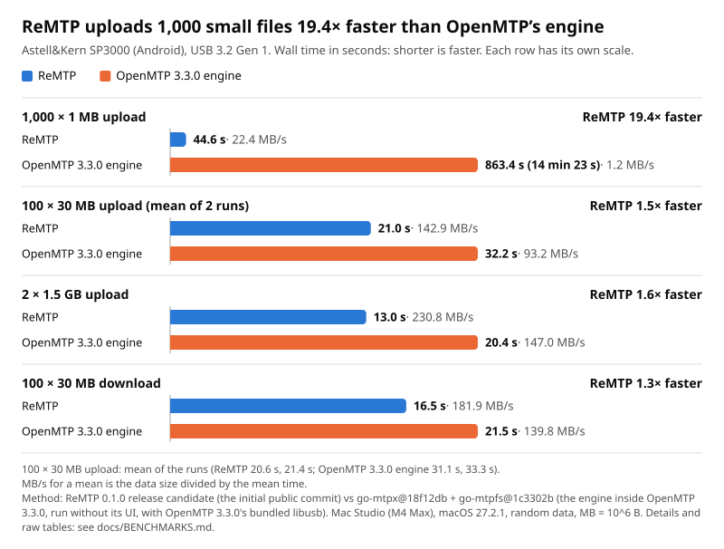
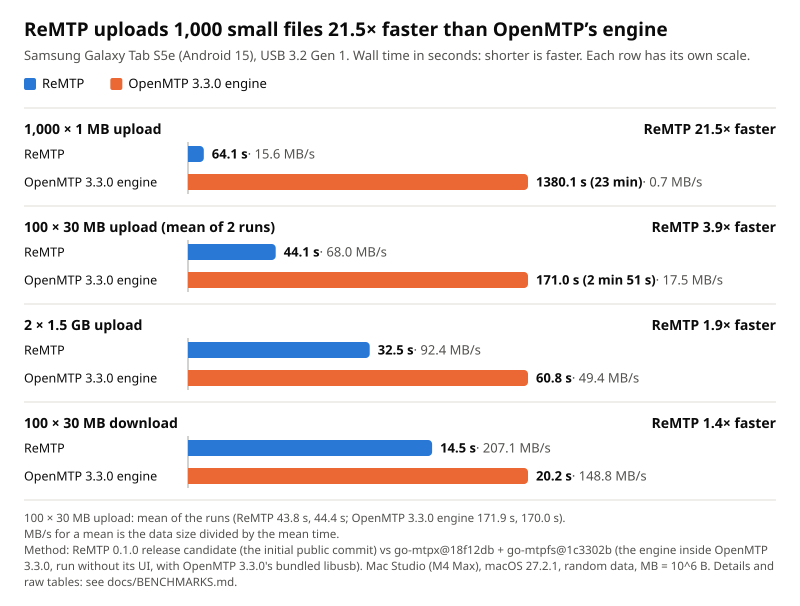
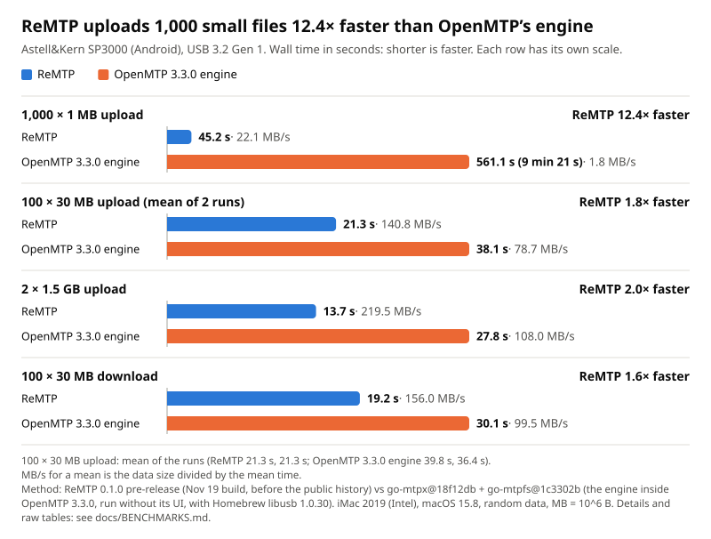
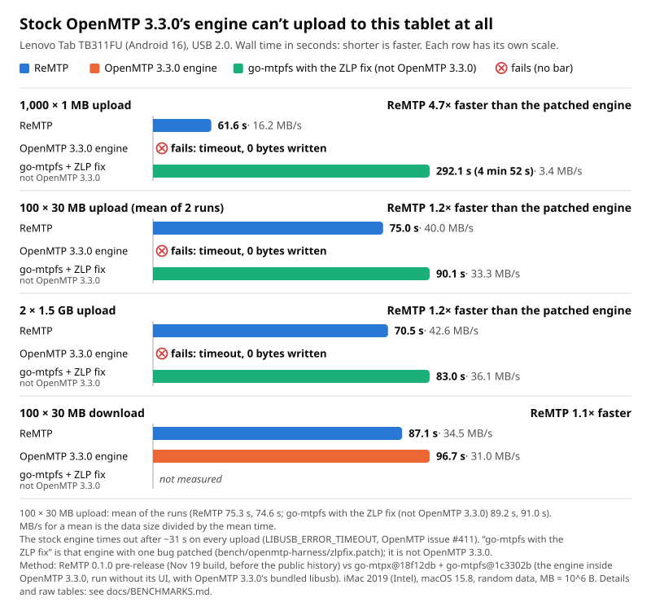

# Benchmarks

ReMTP against OpenMTP 3.3.0's transfer engine, on the same Mac, device, cable and data. The charts are
generated from [benchmarks/results.json](benchmarks/results.json) by `python3 docs/benchmarks/render_charts.py`.
The OpenMTP numbers come from the Go harness in [bench/openmtp-harness](../bench/openmtp-harness/), which runs
the engine without OpenMTP's Electron UI.

<picture>
  <source media="(prefers-color-scheme: dark)" srcset="benchmarks/studio-sp3000-dark.svg">
  
</picture>

<picture>
  <source media="(prefers-color-scheme: dark)" srcset="benchmarks/studio-tab-s5e-dark.svg">
  
</picture>

## 2026-11-22: Mac Studio, ReMTP 0.1.0

- **Mac:** Mac Studio (M4 Max), macOS 27.2.1. Devices on the front USB-C ports, USB 3.2 Gen 1 (5 Gb/s).
- **ReMTP:** `remtp-cli` 0.1.0 release candidate, a release build of the initial public commit's code.
- **OpenMTP engine:** `go-mtpx@18f12db` + `go-mtpfs@1c3302b`, the exact versions linked into OpenMTP 3.3.0's
  `kalam.dylib`, built for arm64 and linked against the `libusb.dylib` bundled in OpenMTP 3.3.0 (the USB stack
  the app itself uses).
- **Data:** random bytes; MB = 10^6 bytes. Every upload was checked on the device by file count and sizes,
  every download by SHA-256. The tools alternate with a 10 s pause; for 100 × 30 MB each ran twice, once first
  and once second.

### Astell&Kern SP3000 (Android DAP), USB 3.2 Gen 1

| Dataset | ReMTP | OpenMTP engine | Speed-up |
| --- | ---: | ---: | ---: |
| 100 × 30 MB upload (run 1) | 20.6 s · 145.6 MB/s | 31.1 s · 96.4 MB/s | 1.5× |
| 100 × 30 MB upload (run 2) | 21.4 s · 140.4 MB/s | 33.3 s · 90.2 MB/s | 1.6× |
| 1,000 × 1 MB upload | 44.6 s · 22.4 MB/s | 863.4 s (14 min 23 s) · 1.2 MB/s | 19.4× |
| 2 × 1.5 GB upload | 13.0 s · 230.8 MB/s | 20.4 s · 147.0 MB/s | 1.6× |
| 100 × 30 MB download | 16.5 s · 181.9 MB/s | 21.5 s · 139.8 MB/s | 1.3× |

### Samsung Galaxy Tab S5e (SM-T720, Android 15), USB 3.2 Gen 1

| Dataset | ReMTP | OpenMTP engine | Speed-up |
| --- | ---: | ---: | ---: |
| 100 × 30 MB upload (run 1) | 43.8 s · 68.5 MB/s | 171.9 s · 17.4 MB/s | 3.9× |
| 100 × 30 MB upload (run 2) | 44.4 s · 67.5 MB/s | 170.0 s · 17.6 MB/s | 3.8× |
| 1,000 × 1 MB upload | 64.1 s · 15.6 MB/s | 1,380.1 s (23 min) · 0.7 MB/s | 21.5× |
| 2 × 1.5 GB upload | 32.5 s · 92.4 MB/s | 60.8 s · 49.4 MB/s | 1.9× |
| 100 × 30 MB download | 14.5 s · 207.1 MB/s | 20.2 s · 148.8 MB/s | 1.4× |

Stock OpenMTP uploads work on this tablet (unlike the Lenovo below). Its time per file still grows with every
file already in the folder, which is where the 23 minutes for 1,000 files come from.

### USB 2.0 cables

Earlier the same night both devices were on USB 2.0 cables. Uploads completed and verified: 1,000 × 1 MB took
78.3 s with ReMTP vs 944.3 s with OpenMTP's engine on the SP3000, and 92.1 s vs 1,424.3 s on the Tab S5e.
Downloads failed on those cables. On both devices ReMTP hit a USB overrun (`kIOReturnOverrun`) on an early
read and then hung instead of failing ([a bug](https://github.com/cro13/ReMTP/issues/1)). On the SP3000, OpenMTP's engine ran first and
also failed, with a malformed response (`CONTAINER_UNDEFINED`); on the Tab S5e it ran after ReMTP's hang and
couldn't open a session. With USB 3 cables in the same ports, every download completed.

## 2026-11-19: iMac 2019, pre-release build

An earlier round on an iMac 2019 (Intel), macOS 15.8, with a pre-release build of 0.1.0 from before the
public history. Same datasets and method, OpenMTP engine built for x86_64.

<picture>
  <source media="(prefers-color-scheme: dark)" srcset="benchmarks/sp3000-dark.svg">
  
</picture>

<picture>
  <source media="(prefers-color-scheme: dark)" srcset="benchmarks/lenovo-dark.svg">
  
</picture>

### Astell&Kern SP3000, USB 3.2 Gen 1

The OpenMTP engine was linked against Homebrew's libusb 1.0.30 for this run.

| Dataset | ReMTP | OpenMTP engine | Speed-up |
| --- | ---: | ---: | ---: |
| 100 × 30 MB upload (run 1) | 21.3 s · 140.8 MB/s · 0.21 s/file | 39.8 s · 75.4 MB/s · 0.40 s/file | 1.9× |
| 100 × 30 MB upload (run 2) | 21.3 s · 140.8 MB/s · 0.21 s/file | 36.4 s · 82.3 MB/s · 0.36 s/file | 1.7× |
| 1,000 × 1 MB upload | 45.2 s · 22.1 MB/s · 0.045 s/file | 561.1 s · 1.8 MB/s · 0.56 s/file | 12.4× |
| 2 × 1.5 GB upload | 13.7 s · 219.5 MB/s | 27.8 s · 108.0 MB/s | 2.0× |
| 100 × 30 MB download | 19.2 s · 156.0 MB/s | 30.1 s · 99.5 MB/s | 1.6× |

With 1,000 files, OpenMTP's time per file grew from 0.11 s to 1.0 s. Before every upload, go-mtpx re-reads
every name already in the destination folder (`GetObjectFromParentIdAndFilename`), so the cost grows with each
file. ReMTP keeps a cached listing and doesn't re-list.

ReMTP per file (`remtp bench`, 100 × 30 MB): 214 ms on average, of which 126 ms is data, 88 ms waiting for
the device (Android scans each received file before it replies) and 2 ms idle between files.

### Lenovo Tab TB311FU (Android 16), USB 2.0

The tablet only links at USB 2.0 (about 40 MB/s at most), so big files are capped by the cable for both
tools. The OpenMTP engine was linked against the libusb bundled in OpenMTP 3.3.0.

**Stock OpenMTP 3.3.0's engine could not upload anything to this tablet.** All 6 attempts failed after ~31 s
with `LIBUSB_ERROR_TIMEOUT` and 0 bytes written. go-mtpfs's `bulkWrite` sends an extra zero-length packet after
every `SendObjectInfo`, and the tablet stops answering (matches OpenMTP issue #411). Downloads work. To still
compare engines, the table also shows go-mtpfs with that one bug patched; **that column is not OpenMTP 3.3.0**.

| Dataset | ReMTP | OpenMTP 3.3.0 engine | Engine with the fix |
| --- | ---: | --- | ---: |
| 100 × 30 MB upload (run 1) | 75.3 s · 39.8 MB/s | fails | 89.2 s · 33.6 MB/s |
| 100 × 30 MB upload (run 2) | 74.6 s · 40.2 MB/s | fails | 91.0 s · 33.0 MB/s |
| 1,000 × 1 MB upload | 61.6 s · 16.2 MB/s | fails | 292.1 s · 3.4 MB/s |
| 2 × 1.5 GB upload | 70.5 s · 42.6 MB/s | fails | 83.0 s · 36.1 MB/s |
| 100 × 30 MB download | 87.1 s · 34.5 MB/s | 96.7 s · 31.0 MB/s | — |

ReMTP per file (`remtp bench`, 100 × 30 MB): 746 ms, of which 709 ms is data, 37 ms device wait and under 1 ms
idle, so the USB 2.0 link is the bottleneck.

## Run your own

```sh
cargo build --release --locked -p remtp-cli
target/release/remtp devices
target/release/remtp bench 0 <storage-id> /Download/remtp-bench --files 100 --size-mb 30
```

The full comparison with OpenMTP's engine is in [bench/openmtp-harness](../bench/openmtp-harness/). Please
share results in a [device report](https://github.com/cro13/ReMTP/issues/new?template=device_report.yml).
